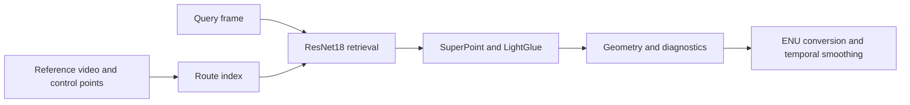

# Visual Route Localization

**A route-based visual localization prototype combining reference indexing, global image retrieval, local feature matching, geometric diagnostics and temporal position smoothing.**

A query frame must be associated with a position along a previously recorded route. Comparing every query to every reference with an expensive local matcher is wasteful, while global image similarity alone can confuse repeated structures. The pipeline uses retrieval to select candidates, local correspondences to examine geometry and temporal filtering to stabilize the reported position.

## Architecture and data flow



## Implementation decisions

1. Reference indexing and runtime query processing are separate services, allowing a prepared route index to be reused rather than recomputed for every query.

2. The selected fast-lock branch uses ResNet18 retrieval before SuperPoint/LightGlue matching. Cached DINOv2 source in another local branch is a third-party dependency; it is not evidence that a new visual backbone was trained here.

3. Local matching and geometric checks provide information beyond global similarity, but their effect on real localization must be measured on independent query sequences.

4. The current ConfidenceEstimator clips inlier_ratio and multiplies it by 100. Similarity, reprojection error and match count do not become a learned, calibrated probability through that calculation.

5. ENU conversion is a local coordinate approximation. Smoothing and reset behavior are isolated so that temporal handling can be tested independently of neural inference.

6. Different route/version branches are alternatives within one localization project. They should be compared as variants rather than presented as several unrelated model-training systems.

## Source navigation

| Module | Responsibility |
| --- | --- |
| `app/indexing_service.py` | Reference-route indexing |
| `app/runtime.py` | Runtime frame processing |
| `app/vloc/retrieval.py` | Global candidate retrieval |
| `app/vloc/matching.py` | SuperPoint/LightGlue matching |
| `app/vloc/geo.py` | Local ENU coordinates |
| `app/vloc/smoothing.py` | EWMA smoothing and reset |

## Reproducible component checks

The minimal checks use Python 3.11/3.12 and `requirements-checks.txt`. They are independent of live accounts, paid APIs and GPU inference. They exercise the specific boundary described below; they are not a measurement of the complete application's model quality.

Linux/macOS, from the repository root:

```bash
python3.11 -m venv .venv
.venv/bin/python -m pip install -r requirements-checks.txt
.venv/bin/python offline_demo.py
.venv/bin/python -m unittest discover -s tests/offline -v
.venv/bin/python scripts/check_source.py
```

Windows PowerShell, from the repository root:

```powershell
py -3.11 -m venv .venv
& ./.venv/Scripts/python.exe -m pip install -r requirements-checks.txt
& ./.venv/Scripts/python.exe offline_demo.py
& ./.venv/Scripts/python.exe -m unittest discover -s tests/offline -v
& ./.venv/Scripts/python.exe scripts/check_source.py
```

### What the replay actually verifies

The small offline suite checks ENU round trips, the confidence range and smoothing/reset behavior using generated coordinates. It does not instantiate Torch/LightGlue, compare images or produce a measured route-localization error.

The recorded example output is in [docs/offline-demo-output.json](docs/offline-demo-output.json). CI checks the minimal suite separately from a Gitleaks secret scan. Source compilation verifies syntax; it does not instantiate every runtime integration.

## Full runtime and configuration

Install a compatible runtime Torch/torchvision and LightGlue stack in its own environment, then prepare authorized reference video, control points, query video and any required model weights. Review the preserved guide for indexing/runtime arguments and the selected configuration. The minimal `requirements-checks.txt` deliberately excludes the full visual stack; successfully running the minimal checks does not mean route matching has run.

Runtime dependencies and configuration notes are documented in [docs/runtime.md](docs/runtime.md). Minimal and full-runtime environments are intentionally separate. Filled local settings, credentials, production exports and original Git history are outside the source export. Configuration examples describe shape and environment references; they are not a working customer account.

## Evaluation protocol

Reference and query sequences must be independently acquired and paired with suitable ground truth. Report position-error p50/p95, localization coverage, false-localization rate, refusal rate and latency. Repeated appearance, lighting changes, motion blur and off-route frames need explicit failure slices. Distance between two reference routes is not an estimate of query localization error.

## Current boundaries

- Confidence is a heuristic score, not a calibrated probability.
- Visual inference and real-route accuracy are not covered by the offline utility tests.
- A pretrained feature extractor is an external model dependency, not an original trained model claim.

This repository presents the reviewed, anonymized source and the reproducible component checks described above. Private account configuration, customer identities, production documents, recordings and original deployment settings are excluded. Full application-level evaluation remains separate from the offline checks.

## Provenance and dependencies

The source export belongs to the author's local project family; technical component boundaries are recorded in [docs/source-provenance.json](docs/source-provenance.json). Third-party libraries, pretrained models and adapters retain their own licenses and attribution; see [THIRD_PARTY.md](THIRD_PARTY.md). No new permissive license is assigned by this documentation update.

Where present, [docs/original-guide.md](docs/original-guide.md) preserves the implementation guide with neutralized service names. It is reference material and must be read together with the current runtime and validation boundaries above. It is not a claim of production readiness.
